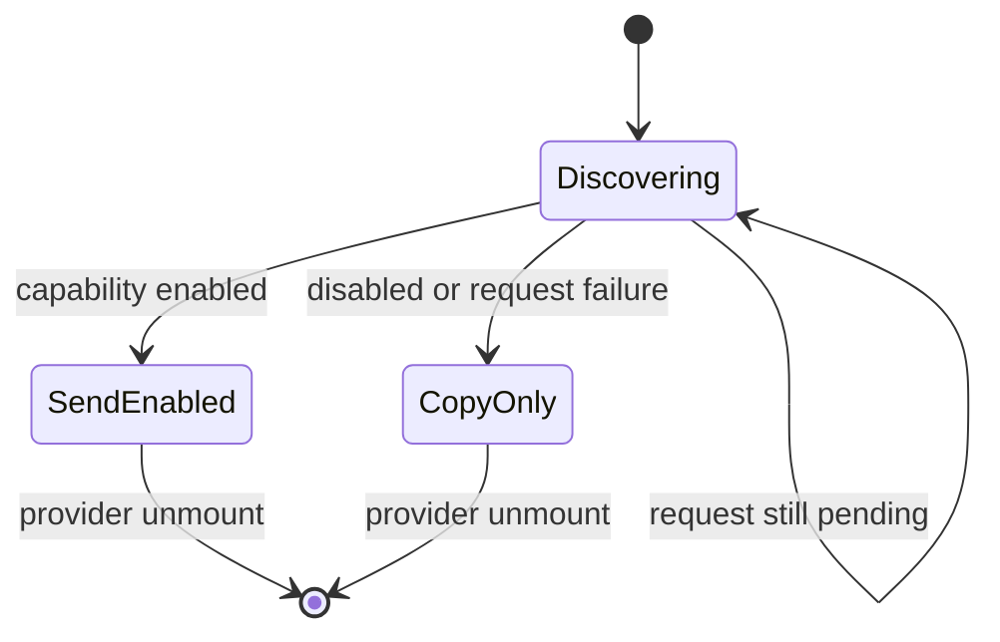
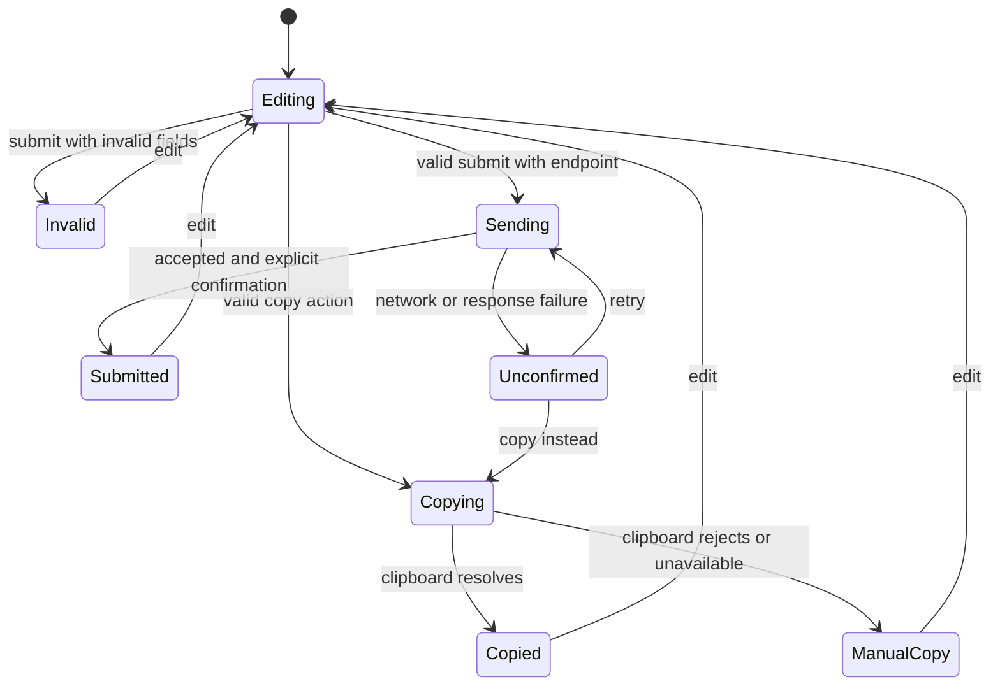
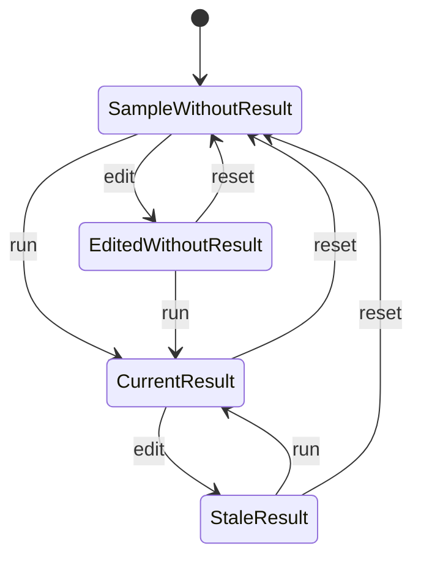
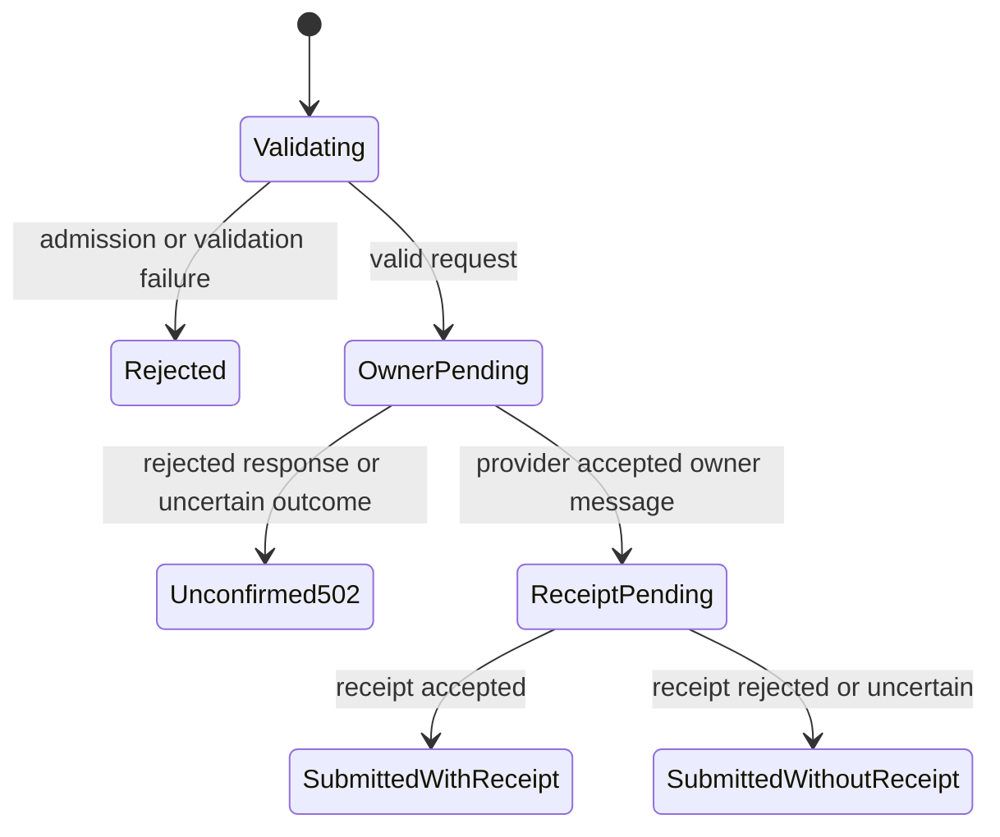

# BuildMyX implicit state machine audit

Reviewed on 12 November 2026 against commit `866d1ad`.

## Remediation

The baseline inventory below records the audited version. The confirmed findings and concrete follow-ups have now been implemented:

| Item                                      | Resolution                                                                                                                                                                                                                                                       | Current implementation / checks                                                                                         |
| ----------------------------------------- | ---------------------------------------------------------------------------------------------------------------------------------------------------------------------------------------------------------------------------------------------------------------- | ----------------------------------------------------------------------------------------------------------------------- |
| F1: retry identity lost on navigation     | The root provider owns draft, current action, normalized submission identity and accepted outcome. Same-payload retries survive form remounts and do not issue duplicate calls after known acceptance.                                                           | `lib/enquiry-machine.ts`, `components/enquiry-provider.tsx`, navigation regression in `scripts/state-machine-check.mjs` |
| F2: stale send/copy completions           | Every operation owns an immutable snapshot, revision and operation token. Editing preserves the pending operation but invalidates its visible completion; old callbacks cannot confirm current fields or create empty manual-copy feedback.                      | Domain tests and delayed-response/clipboard browser regressions                                                         |
| F3: stale copy instructions after sending | Typed action phases make prepared-copy and sending/submitted feedback mutually exclusive.                                                                                                                                                                        | Capability-discovery/copy/send browser regression                                                                       |
| F4: partial interest reset                | Interest changes and ordinary field edits use one `EDIT` transition that clears the relevant validation error and resets terminal operation feedback.                                                                                                            | Domain tests and failure-to-interest-change browser regression                                                          |
| Delivery discovery                        | Distinct checking, available, copy-only and error states; a five-second timeout, generation guards and a user retry action.                                                                                                                                      | `components/enquiry-provider.tsx`; timeout/retry browser regression                                                     |
| Clipboard permission                      | Fifteen-second timeout enters a complete manual-copy state with an owned message and selected textarea.                                                                                                                                                          | Clipboard-timeout browser regression                                                                                    |
| Report state                              | Explicit sample, edited-without-result, current and stale states; stale provenance/export stays blocked. Reset restores the sample and Compare weeks selection.                                                                                                  | `lib/reporting-machine.ts` and its tests; report reset browser regression                                               |
| Hero state                                | Run intent, media preference, explicit motion override, hover and focus are separate inputs. A guarded timer selector controls ticks. Explicit Resume under reduced motion retains the documented policy.                                                        | `lib/hero-machine.ts` and its tests; existing hero browser journeys                                                     |
| Native browser behavior                   | FAQ exclusivity and media controls remain browser-owned, with existing browser coverage.                                                                                                                                                                         | `components/landing.tsx`, `components/service-page.tsx`, reporting walkthrough                                          |
| Analytics lifetimes and fallback          | Start tracking is once per persistent draft; pathname effects are deduplicated; downloads remain attempts. Destination validation permits a configured HTTPS fallback and rechecks privacy preferences.                                                          | `components/analytics.tsx`, `lib/analytics-destination.ts`, analytics tests and browser checks                          |
| Durable server delivery                   | Convex records payload fingerprints, stable references, leases and separate owner/receipt outcomes. Replays return cached results, conflicting payloads and concurrent claims are rejected, and interrupted owner acceptance resumes without another owner send. | `convex/enquiryDelivery.ts`, `lib/server/enquiries.ts`, Node and Convex tests                                           |
| Shared rate limits and cleanup            | Official Convex rate-limiter component replaces process-local counters. Indexed, bounded cleanup removes expired delivery metadata and inactive protected rate keys.                                                                                             | `convex/convex.config.ts`, `convex/crons.ts`, component/cleanup tests                                                   |
| Service access                            | Internal mutations are exposed only through a bounded HTTP action authenticated with Web Crypto HMAC verification and a short timestamp window. Missing/weak keys disable it.                                                                                    | `convex/http.ts`; signed, tampered, expired and unsigned-request tests                                                  |
| Route focus robustness                    | Malformed encoded fragments fall back safely instead of being decoded without a guard.                                                                                                                                                                           | `components/header.tsx`                                                                                                 |

The backend is installed on the existing **development** deployment `tacit-badger-38`. Signed health checks succeed and unsigned requests return 401. Production email activation still needs the production service URL/secret and verified Resend settings in Vercel, as documented in [README](../README.md). This is configuration for enabling sending; the website continues to offer its copy flow while sending is unconfigured.

Delivery metadata has a 30-day cleanup policy. This is bounded idempotency retention, not permanent duplicate detection; fresh documents also begin new drafts. The public privacy page now describes the metadata and protected rate keys.

The app contains implicit state machines in enquiries, the hero, navigation, the reporting demo, analytics, server request handling, and browser controls. The inventory below identifies 25 behavioral regions. Several are nested or concurrent parts of one workflow, rather than 25 independent features.

An implicit machine is behavior whose next result depends on both the current state and an event. State can live in React, refs, module variables, a request, an algorithm's working memory, or the browser DOM. A boolean by itself is not a defect; the important questions are which transitions are allowed and how long the state survives.

## Scope and method

- Inspected authored application code under `app/`, `components/`, `lib/`, the Convex schema, configuration, and relevant existing tests.
- Used TypeScript's syntax tree to account for every React state hook: **21 `useState` calls, 9 `useRef` calls, 10 `useEffect` calls, and no `useReducer` calls**. The state cells are in five components; `Analytics` adds an effect without local state.
- Checked module memory, timers, async requests, URL-driven behavior, native disclosures, media, and generated download URLs in addition to hooks.
- Ran controlled browser probes against the existing local production build. Enquiry responses and clipboard outcomes were simulated; external requests were blocked. Five enquiry transition failures were reproduced. An additional malformed-fragment probe was inconclusive and is excluded from confirmed findings.
- Third-party SDK and framework internals are grouped at their application boundaries. Ordinary CSS hover/focus transitions are visual projections of DOM state, rather than separate business workflows.

Source links below point to the audited commit. This is an analysis report; application code and live deployments were not changed for this audit.

## Baseline inventory

### Enquiries

| ID  | Machine / state region                     | Current states and transition events                                                                                                                                                                                                                                                                                                                                                                                                       | Source                                                                                                                                                                                                                                                                                                                                                                                                                                                                                                                                                              |
| --- | ------------------------------------------ | ------------------------------------------------------------------------------------------------------------------------------------------------------------------------------------------------------------------------------------------------------------------------------------------------------------------------------------------------------------------------------------------------------------------------------------------ | ------------------------------------------------------------------------------------------------------------------------------------------------------------------------------------------------------------------------------------------------------------------------------------------------------------------------------------------------------------------------------------------------------------------------------------------------------------------------------------------------------------------------------------------------------------------- |
| M01 | Tab-local enquiry draft                    | Empty → populated on field edits; further edits replace individual fields. Client navigation preserves the provider's draft. A fresh document starts a new draft. Successful sending does not clear it.                                                                                                                                                                                                                                    | [enquiry-provider.tsx:57](https://github.com/vishalsingh17/BuildMyX/blob/866d1ad/components/enquiry-provider.tsx#L57), [enquiry-form.tsx:58](https://github.com/vishalsingh17/BuildMyX/blob/866d1ad/components/enquiry-form.tsx#L58), [layout.tsx:77](https://github.com/vishalsingh17/BuildMyX/blob/866d1ad/app/layout.tsx#L77)                                                                                                                                                                                                                                    |
| M02 | Enquiry interest and its competing inputs  | Four states: `ai`, `learning`, `hiring`, `developer`. Events come from valid URL query changes, the select, hero choices/CTA, landing service CTAs, navigation CTAs, and service enquiry links. Missing/invalid query values leave the current interest unchanged. URL and form selection are not continuously synchronized: changing the select does not rewrite the URL.                                                                 | [enquiry-provider.tsx:52](https://github.com/vishalsingh17/BuildMyX/blob/866d1ad/components/enquiry-provider.tsx#L52), [enquiry-provider.tsx:86](https://github.com/vishalsingh17/BuildMyX/blob/866d1ad/components/enquiry-provider.tsx#L86), [enquiry-link.tsx:25](https://github.com/vishalsingh17/BuildMyX/blob/866d1ad/components/enquiry-link.tsx#L25), [landing.tsx:15](https://github.com/vishalsingh17/BuildMyX/blob/866d1ad/components/landing.tsx#L15), [header.tsx:73](https://github.com/vishalsingh17/BuildMyX/blob/866d1ad/components/header.tsx#L73) |
| M03 | Delivery capability discovery              | Configured external endpoint → send enabled immediately. Otherwise probing `/api/enquiry` → local sending enabled only for `{enabled:true}`. Disabled responses, errors, and pending discovery all share `deliveryEndpoint === null`, so all show the copy action. Discovery happens once per provider mount; cleanup aborts it. There is no timeout or retry transition.                                                                  | [enquiry-provider.tsx:38](https://github.com/vishalsingh17/BuildMyX/blob/866d1ad/components/enquiry-provider.tsx#L38), [route.ts:6](https://github.com/vishalsingh17/BuildMyX/blob/866d1ad/app/api/enquiry/route.ts#L6)                                                                                                                                                                                                                                                                                                                                             |
| M04 | Field validation feedback                  | Initially unchecked → errors on invalid submit → an individual error is cleared when that field is edited. Clearing feedback does not prove the edited value is valid; submit validates again. An interest change clears its error. A failed validation focuses the first invalid field and never starts the action.                                                                                                                       | [enquiry-form.tsx:36](https://github.com/vishalsingh17/BuildMyX/blob/866d1ad/components/enquiry-form.tsx#L36), [enquiry-form.tsx:58](https://github.com/vishalsingh17/BuildMyX/blob/866d1ad/components/enquiry-form.tsx#L58), [enquiry-form.tsx:71](https://github.com/vishalsingh17/BuildMyX/blob/866d1ad/components/enquiry-form.tsx#L71), [enquiry.ts:14](https://github.com/vishalsingh17/BuildMyX/blob/866d1ad/lib/enquiry.ts#L14)                                                                                                                             |
| M05 | Enquiry action and asynchronous completion | Idle → synchronous validation → sending or copying. Sending resolves to submitted with confirmation, submitted without confirmed receipt, or delivery unconfirmed. Copying enters M06. `finally` clears `busy`; errors set `failed`. Rendering is assembled from `busy`, free-text `status`, `failed`, `prepared`, and `manualCopy`, rather than one operation state. Only action buttons are disabled while busy; inputs remain editable. | [enquiry-form.tsx:37](https://github.com/vishalsingh17/BuildMyX/blob/866d1ad/components/enquiry-form.tsx#L37), [enquiry-form.tsx:66](https://github.com/vishalsingh17/BuildMyX/blob/866d1ad/components/enquiry-form.tsx#L66), [enquiry-form.tsx:257](https://github.com/vishalsingh17/BuildMyX/blob/866d1ad/components/enquiry-form.tsx#L257), [enquiry.ts:72](https://github.com/vishalsingh17/BuildMyX/blob/866d1ad/lib/enquiry.ts#L72)                                                                                                                           |
| M06 | Prepared message and clipboard fallback    | No message → prepared snapshot → clipboard pending → copied, or manual copy after rejection/unavailability. Manual copy focuses and selects the prepared textarea. Edits and interest changes clear the prepared snapshot. A copy fallback is available after sending fails. Clipboard results have no draft-version guard.                                                                                                                | [enquiry-form.tsx:40](https://github.com/vishalsingh17/BuildMyX/blob/866d1ad/components/enquiry-form.tsx#L40), [enquiry-form.tsx:51](https://github.com/vishalsingh17/BuildMyX/blob/866d1ad/components/enquiry-form.tsx#L51), [enquiry-form.tsx:99](https://github.com/vishalsingh17/BuildMyX/blob/866d1ad/components/enquiry-form.tsx#L99), [enquiry-form.tsx:287](https://github.com/vishalsingh17/BuildMyX/blob/866d1ad/components/enquiry-form.tsx#L287)                                                                                                        |
| M07 | Submission identity and retry              | No identity → `{body,id}` on first send. The same serialized body reuses the ID; a different body creates a new UUID. The ref survives renders but is discarded when the form unmounts. The persistent draft and its retry identity therefore have different lifetimes.                                                                                                                                                                    | [enquiry-form.tsx:44](https://github.com/vishalsingh17/BuildMyX/blob/866d1ad/components/enquiry-form.tsx#L44), [enquiry-form.tsx:85](https://github.com/vishalsingh17/BuildMyX/blob/866d1ad/components/enquiry-form.tsx#L85), [enquiry.ts:83](https://github.com/vishalsingh17/BuildMyX/blob/866d1ad/lib/enquiry.ts#L83)                                                                                                                                                                                                                                            |
| M08 | Enquiry-start analytics latch              | Not started → started on the first focus captured inside the form. It emits one `enquiry_start` attempt per form mount, even if delivery is unavailable. A remount resets the latch despite retaining the draft. Privacy settings can suppress transmission of that event.                                                                                                                                                                 | [enquiry-form.tsx:45](https://github.com/vishalsingh17/BuildMyX/blob/866d1ad/components/enquiry-form.tsx#L45), [enquiry-form.tsx:140](https://github.com/vishalsingh17/BuildMyX/blob/866d1ad/components/enquiry-form.tsx#L140)                                                                                                                                                                                                                                                                                                                                      |

### Hero and navigation

| ID  | Machine / state region                 | Current states and transition events                                                                                                                                                                                                                                                                                                                                                                                                                                                                                                           | Source                                                                                                                                                                                                                                                                                                                                                                                                                                                                                      |
| --- | -------------------------------------- | ---------------------------------------------------------------------------------------------------------------------------------------------------------------------------------------------------------------------------------------------------------------------------------------------------------------------------------------------------------------------------------------------------------------------------------------------------------------------------------------------------------------------------------------------- | ------------------------------------------------------------------------------------------------------------------------------------------------------------------------------------------------------------------------------------------------------------------------------------------------------------------------------------------------------------------------------------------------------------------------------------------------------------------------------------------- |
| M09 | Hero service mode and saved preference | `X`, `AI`, `Career`, `Team`. `X` displays AI supporting content. Timer sequence is `X → AI → Career → Team → AI…`; `X` is the initial mode, not part of the repeating cycle. Manual selection updates the provider's saved mode and enquiry interest. Autoplay only updates the local mode. Remount uses the saved preference snapshot.                                                                                                                                                                                                        | [hero.tsx:16](https://github.com/vishalsingh17/BuildMyX/blob/866d1ad/components/hero.tsx#L16), [hero.tsx:23](https://github.com/vishalsingh17/BuildMyX/blob/866d1ad/components/hero.tsx#L23), [hero.tsx:45](https://github.com/vishalsingh17/BuildMyX/blob/866d1ad/components/hero.tsx#L45), [hero.tsx:54](https://github.com/vishalsingh17/BuildMyX/blob/866d1ad/components/hero.tsx#L54)                                                                                                  |
| M10 | Hero rotation controller               | Before hydration, stopped with reduced motion assumed. Mount checks the media preference and saved pause intent. Active ticking requires `running && !hovered && !focused`; ticks occur every 3.9 seconds. Hover/focus temporarily suspend the timer without changing run intent. Manual selection/primary CTA pause; Pause/Resume toggles persist intent. Enabling reduced motion stops rotation; disabling it does not automatically resume. Explicit Resume can run it while reduced motion remains enabled; CSS transitions stay disabled. | [hero.tsx:25](https://github.com/vishalsingh17/BuildMyX/blob/866d1ad/components/hero.tsx#L25), [hero.tsx:31](https://github.com/vishalsingh17/BuildMyX/blob/866d1ad/components/hero.tsx#L31), [hero.tsx:43](https://github.com/vishalsingh17/BuildMyX/blob/866d1ad/components/hero.tsx#L43), [hero.tsx:94](https://github.com/vishalsingh17/BuildMyX/blob/866d1ad/components/hero.tsx#L94), [hero.tsx:124](https://github.com/vishalsingh17/BuildMyX/blob/866d1ad/components/hero.tsx#L124) |
| M11 | Mobile navigation disclosure           | Closed ↔ open via toggle. Opening focuses the first link and installs Escape handling. Escape closes and restores toggle focus. Link selection, pathname change, focus leaving the menu, or widening to desktop also close it. The DOM focus target and viewport are state inputs alongside `open`.                                                                                                                                                                                                                                            | [header.tsx:36](https://github.com/vishalsingh17/BuildMyX/blob/866d1ad/components/header.tsx#L36), [header.tsx:49](https://github.com/vishalsingh17/BuildMyX/blob/866d1ad/components/header.tsx#L49), [header.tsx:61](https://github.com/vishalsingh17/BuildMyX/blob/866d1ad/components/header.tsx#L61), [header.tsx:118](https://github.com/vishalsingh17/BuildMyX/blob/866d1ad/components/header.tsx#L118)                                                                                |
| M12 | Route/fragment focus handoff           | The header remembers the previous pathname. A pathname change closes the menu and focuses the hash target, or `main` when no hash exists. Same-page contact links in the header/enquiry-link perform a separate animation-frame focus handoff. Native anchors handle other fragment jumps. Hash/query-only changes do not run the pathname effect.                                                                                                                                                                                             | [header.tsx:14](https://github.com/vishalsingh17/BuildMyX/blob/866d1ad/components/header.tsx#L14), [header.tsx:39](https://github.com/vishalsingh17/BuildMyX/blob/866d1ad/components/header.tsx#L39), [header.tsx:73](https://github.com/vishalsingh17/BuildMyX/blob/866d1ad/components/header.tsx#L73), [enquiry-link.tsx:28](https://github.com/vishalsingh17/BuildMyX/blob/866d1ad/components/enquiry-link.tsx#L28)                                                                      |

### Reporting and downloads

| ID  | Machine / state region                      | Current states and transition events                                                                                                                                                                                                                                                                                                                                                                                                | Source                                                                                                                                                                                                                                                                                                                                                                                                                                                                         |
| --- | ------------------------------------------- | ----------------------------------------------------------------------------------------------------------------------------------------------------------------------------------------------------------------------------------------------------------------------------------------------------------------------------------------------------------------------------------------------------------------------------------- | ------------------------------------------------------------------------------------------------------------------------------------------------------------------------------------------------------------------------------------------------------------------------------------------------------------------------------------------------------------------------------------------------------------------------------------------------------------------------------ |
| M13 | Report inputs, snapshot and freshness       | Initial sample without a result; edited inputs without a result; current result; stale result after edits. Run computes synchronously and clears dirty/highlights. Editing retains the old result, marks it stale, and clears highlights. Reset restores sample rows and removes the result. Stale results disable explanation controls, source tracing, and export.                                                                | [reporting-demo.tsx:15](https://github.com/vishalsingh17/BuildMyX/blob/866d1ad/components/reporting-demo.tsx#L15), [reporting-demo.tsx:27](https://github.com/vishalsingh17/BuildMyX/blob/866d1ad/components/reporting-demo.tsx#L27), [reporting-demo.tsx:155](https://github.com/vishalsingh17/BuildMyX/blob/866d1ad/components/reporting-demo.tsx#L155), [reporting-demo.tsx:185](https://github.com/vishalsingh17/BuildMyX/blob/866d1ad/components/reporting-demo.tsx#L185) |
| M14 | Report explanation selection                | `change`, `checks`, or `sources`. Buttons change the selected explanation only when results are current. Reset and rerun retain this selection; reset hides the result until the next run. This is independent of report freshness.                                                                                                                                                                                                 | [reporting-demo.tsx:22](https://github.com/vishalsingh17/BuildMyX/blob/866d1ad/components/reporting-demo.tsx#L22), [reporting-demo.tsx:210](https://github.com/vishalsingh17/BuildMyX/blob/866d1ad/components/reporting-demo.tsx#L210)                                                                                                                                                                                                                                         |
| M15 | Source provenance selection and focus       | No highlighted rows → one flagged row or a set of accepted source rows. Selecting sources sets indexes and focuses the first row. Edit, rerun, and reset clear selection. Stale results and empty total sources disable the corresponding controls.                                                                                                                                                                                 | [reporting-demo.tsx:25](https://github.com/vishalsingh17/BuildMyX/blob/866d1ad/components/reporting-demo.tsx#L25), [reporting-demo.tsx:41](https://github.com/vishalsingh17/BuildMyX/blob/866d1ad/components/reporting-demo.tsx#L41), [reporting-demo.tsx:199](https://github.com/vishalsingh17/BuildMyX/blob/866d1ad/components/reporting-demo.tsx#L199), [reporting-demo.tsx:250](https://github.com/vishalsingh17/BuildMyX/blob/866d1ad/components/reporting-demo.tsx#L250) |
| M16 | Per-run row validation and duplicate memory | Algorithmic state, reset for every `runReport` call. Each ID changes from unseen to seen even when its first record is invalid. Each row enters accepted or flagged according to the first failing check: ID, duplicate, period, account, then amount. Accepted rows accumulate into totals. A zero Week 1 total produces an unavailable percentage instead of division by zero. This working state is not a persistent data store. | [reporting.ts:40](https://github.com/vishalsingh17/BuildMyX/blob/866d1ad/lib/reporting.ts#L40), [reporting.ts:55](https://github.com/vishalsingh17/BuildMyX/blob/866d1ad/lib/reporting.ts#L55), [reporting.ts:67](https://github.com/vishalsingh17/BuildMyX/blob/866d1ad/lib/reporting.ts#L67)                                                                                                                                                                                 |
| M17 | Download attempt and generated URL lifetime | Checked-report export is permitted only with a current result. It builds a CSV → creates a Blob URL → clicks a download link → revokes the URL after one second. Static sample/worksheet links delegate downloads directly to the browser. `resource_download` records an attempt, not verified completion; there is no application download-success/failure state.                                                                 | [reporting-demo.tsx:45](https://github.com/vishalsingh17/BuildMyX/blob/866d1ad/components/reporting-demo.tsx#L45), [reporting-demo.tsx:79](https://github.com/vishalsingh17/BuildMyX/blob/866d1ad/components/reporting-demo.tsx#L79), [resource-page.tsx:41](https://github.com/vishalsingh17/BuildMyX/blob/866d1ad/components/resource-page.tsx#L41)                                                                                                                          |

### Browser-owned controls

| ID  | Machine / state region | Current states and transition events                                                                                                                                                                                                                                                                     | Source                                                                                                                                                                                                                 |
| --- | ---------------------- | -------------------------------------------------------------------------------------------------------------------------------------------------------------------------------------------------------------------------------------------------------------------------------------------------------- | ---------------------------------------------------------------------------------------------------------------------------------------------------------------------------------------------------------------------- |
| M18 | FAQ accordion          | All closed, or one item open in each named `details` group. Activating a summary toggles it; opening another item closes its sibling in browsers supporting exclusive named groups. The browser owns `open` and keyboard behavior; React has no accordion state. Lifetime follows the mounted DOM nodes. | [landing.tsx:327](https://github.com/vishalsingh17/BuildMyX/blob/866d1ad/components/landing.tsx#L327), [service-page.tsx:195](https://github.com/vishalsingh17/BuildMyX/blob/866d1ad/components/service-page.tsx#L195) |
| M19 | Walkthrough media      | Poster/unloaded with `preload="none"` → loading/ready → playing, paused, seeking/buffering, ended, or error. Playback position, sound, captions, and fullscreen are browser-owned regions. The app supplies sources and native controls; it has no custom playback or failure recovery machine.          | [reporting-pipeline/page.tsx:58](https://github.com/vishalsingh17/BuildMyX/blob/866d1ad/app/projects/reporting-pipeline/page.tsx#L58)                                                                                  |

### Analytics

| ID  | Machine / state region                       | Current states and transition events                                                                                                                                                                                                                                                                                                                                                                                                                                                                       | Source                                                                                                                                                                                                                                                                                                                                                                                                                     |
| --- | -------------------------------------------- | ---------------------------------------------------------------------------------------------------------------------------------------------------------------------------------------------------------------------------------------------------------------------------------------------------------------------------------------------------------------------------------------------------------------------------------------------------------------------------------------------------------- | -------------------------------------------------------------------------------------------------------------------------------------------------------------------------------------------------------------------------------------------------------------------------------------------------------------------------------------------------------------------------------------------------------------------------- |
| M20 | Analytics permission and destination routing | Server/unknown event → ignored. DNT/GPC → ignored before local dispatch. Otherwise dispatch a local `buildmyx:analytics` event. With external analytics disabled, stop there. With a token/host, lazily choose PostHog; otherwise use the optional collector, or stop with no destination. Rejected imports/fetches are swallowed. Invalid PostHog configuration does not fall through to the alternative collector once the PostHog branch has been chosen.                                               | [analytics.ts:72](https://github.com/vishalsingh17/BuildMyX/blob/866d1ad/lib/analytics.ts#L72), [site-config.ts:18](https://github.com/vishalsingh17/BuildMyX/blob/866d1ad/lib/site-config.ts#L18), [posthog-config.ts:9](https://github.com/vishalsingh17/BuildMyX/blob/866d1ad/lib/posthog-config.ts#L9)                                                                                                                 |
| M21 | Lazy PostHog module and SDK initialization   | Import unrequested → importing → resolved or failed. Within the resolved module, `initialized: false → true` after calling `posthog.init`; later captures reuse that instance. Destination/privacy guards can stop capture. `initialized` represents initialization invocation, not delivery acknowledgment. SDK buffering/retries are delegated to PostHog. Event sanitization and a final privacy guard run before send. Memory-only identifiers survive SPA navigation and reset with a fresh document. | [analytics.ts:85](https://github.com/vishalsingh17/BuildMyX/blob/866d1ad/lib/analytics.ts#L85), [posthog-client.ts:9](https://github.com/vishalsingh17/BuildMyX/blob/866d1ad/lib/posthog-client.ts#L9), [posthog-client.ts:26](https://github.com/vishalsingh17/BuildMyX/blob/866d1ad/lib/posthog-client.ts#L26), [posthog-config.ts:74](https://github.com/vishalsingh17/BuildMyX/blob/866d1ad/lib/posthog-config.ts#L74) |
| M22 | Route observation and page/service events    | Mount or pathname change → `page_view`, plus `service_view` for the four mapped service/developer routes. Query/hash-only navigation leaves the dependency unchanged and emits no new page view. The remembered dependency is React effect state. This records route effects, not a visitor's complete enquiry journey.                                                                                                                                                                                    | [analytics.tsx:7](https://github.com/vishalsingh17/BuildMyX/blob/866d1ad/components/analytics.tsx#L7)                                                                                                                                                                                                                                                                                                                      |

### Server

| ID  | Machine / state region                           | Current states and transition events                                                                                                                                                                                                                                                                                                                                                                                                                                                                                                                                                         | Source                                                                                                                                                                                                                                                                                                                                                                                                                                                                                                                         |
| --- | ------------------------------------------------ | -------------------------------------------------------------------------------------------------------------------------------------------------------------------------------------------------------------------------------------------------------------------------------------------------------------------------------------------------------------------------------------------------------------------------------------------------------------------------------------------------------------------------------------------------------------------------------------------- | ------------------------------------------------------------------------------------------------------------------------------------------------------------------------------------------------------------------------------------------------------------------------------------------------------------------------------------------------------------------------------------------------------------------------------------------------------------------------------------------------------------------------------ |
| M23 | Request admission, stream reading and validation | Request enters configuration, origin, content-type, declared-size, rate-limit, streamed-size, JSON, record-shape, honeypot, field-type, and field-value guards in that order. Any failed guard terminates with its error response. Successful validation passes normalized fields to M24. Oversized streaming cancels the reader. State lives in this request's locals.                                                                                                                                                                                                                      | [enquiries.ts:51](https://github.com/vishalsingh17/BuildMyX/blob/866d1ad/lib/server/enquiries.ts#L51), [enquiries.ts:84](https://github.com/vishalsingh17/BuildMyX/blob/866d1ad/lib/server/enquiries.ts#L84), [enquiries.ts:108](https://github.com/vishalsingh17/BuildMyX/blob/866d1ad/lib/server/enquiries.ts#L108)                                                                                                                                                                                                          |
| M24 | Business email and visitor receipt               | Validated → owner message pending → owner acceptance or rejected/unconfirmed outcome. Owner failure returns 502 without sending a receipt. Owner acceptance → receipt pending → receipt accepted or unconfirmed. Both receipt outcomes return `{delivered:true}` with the appropriate `confirmationSent` flag. Provider acceptance is not proof of inbox delivery. Each provider call has a 12-second timeout; the client has a 30-second timeout. Stable request IDs produce distinct owner/receipt idempotency keys. There is no durable application delivery record or webhook lifecycle. | [enquiries.ts:132](https://github.com/vishalsingh17/BuildMyX/blob/866d1ad/lib/server/enquiries.ts#L132), [enquiries.ts:137](https://github.com/vishalsingh17/BuildMyX/blob/866d1ad/lib/server/enquiries.ts#L137), [enquiries.ts:158](https://github.com/vishalsingh17/BuildMyX/blob/866d1ad/lib/server/enquiries.ts#L158), [enquiries.ts:178](https://github.com/vishalsingh17/BuildMyX/blob/866d1ad/lib/server/enquiries.ts#L178), [enquiry.ts:86](https://github.com/vishalsingh17/BuildMyX/blob/866d1ad/lib/enquiry.ts#L86) |
| M25 | Per-instance request windows                     | Missing bucket → counts 1…5 → blocked until the fixed 10-minute expiry → missing again. Expiration is cleaned on requests and by a timer; its expiry check protects a newer bucket from an old timer. At 1,000 active buckets, new keys are blocked. The forwarded address selects a bucket; absent addresses share `unknown`. State is isolated per server instance and disappears on restart. Validation failures after admission also consume an attempt.                                                                                                                                 | [enquiries.ts:11](https://github.com/vishalsingh17/BuildMyX/blob/866d1ad/lib/server/enquiries.ts#L11), [enquiries.ts:21](https://github.com/vishalsingh17/BuildMyX/blob/866d1ad/lib/server/enquiries.ts#L21), [enquiries.ts:73](https://github.com/vishalsingh17/BuildMyX/blob/866d1ad/lib/server/enquiries.ts#L73)                                                                                                                                                                                                            |

## Configuration gates, rather than runtime machines

| Gate                           | Inputs and resulting behavior                                                                                                                                                                                                                                                                                    | Source                                                                                                                                                                                                                                                                                                                                                               |
| ------------------------------ | ---------------------------------------------------------------------------------------------------------------------------------------------------------------------------------------------------------------------------------------------------------------------------------------------------------------- | -------------------------------------------------------------------------------------------------------------------------------------------------------------------------------------------------------------------------------------------------------------------------------------------------------------------------------------------------------------------- |
| Search indexing                | Approval, canonical HTTPS URL, and deployment stage determine indexability and sitemap publication. Preview/development stages remain excluded. These are configuration decisions evaluated by metadata/route generation, not visitor-triggered transitions.                                                     | [launch.ts:2](https://github.com/vishalsingh17/BuildMyX/blob/866d1ad/lib/launch.ts#L2), [layout.tsx:53](https://github.com/vishalsingh17/BuildMyX/blob/866d1ad/app/layout.tsx#L53), [robots.ts:4](https://github.com/vishalsingh17/BuildMyX/blob/866d1ad/app/robots.ts#L4), [sitemap.ts:4](https://github.com/vishalsingh17/BuildMyX/blob/866d1ad/app/sitemap.ts#L4) |
| Optional business destinations | Configured email, booking, and LinkedIn destinations determine which contact links appear. Clicking an available booking link attempts an analytics event. There is no in-app booking, calendar, or contact-verification lifecycle. Delivery credentials and analytics configuration are covered by M03/M20/M23. | [site-config.ts:7](https://github.com/vishalsingh17/BuildMyX/blob/866d1ad/lib/site-config.ts#L7), [landing.tsx:366](https://github.com/vishalsingh17/BuildMyX/blob/866d1ad/components/landing.tsx#L366), [footer.tsx:29](https://github.com/vishalsingh17/BuildMyX/blob/866d1ad/components/footer.tsx#L29)                                                           |

Convex currently has an empty [schema](https://github.com/vishalsingh17/BuildMyX/blob/866d1ad/convex/schema.ts#L1), with no authored application functions. Linking the cloud deployment has not introduced a database-backed enquiry, login/session, lead-processing, or job lifecycle to audit. The learning path and downloadable briefs describe processes; they are not interactive progress trackers.

## State lifetimes

| Lifetime                         | State owned here                                                                                       | Consequence                                                                                                       |
| -------------------------------- | ------------------------------------------------------------------------------------------------------ | ----------------------------------------------------------------------------------------------------------------- |
| Root provider / current document | Draft, interest, detected endpoint, saved hero preference                                              | Survives client navigation; a fresh document resets it.                                                           |
| Home component mount             | Form feedback, in-flight UI operation, submission ID, start-event latch, live hero mode/rotation flags | Navigation away discards these even though the draft survives. Async work is not explicitly cancelled on unmount. |
| Reporting component mount        | Source edits, result snapshot, dirty flag, selected question, highlighted rows                         | Local demo work is discarded on remount.                                                                          |
| DOM element                      | Focus, native FAQ open state, media playback state                                                     | Browser-managed; removal/remount and browser restoration policies govern retention.                               |
| Browser module / SDK instance    | PostHog initialization and anonymous in-memory visit identifiers                                       | Persists across SPA routes, not a new document.                                                                   |
| Individual report invocation     | Seen IDs, accepted/flagged rows, running totals                                                        | Rebuilt from inputs each run.                                                                                     |
| Individual server request        | Body-reading progress, validation, owner/receipt outcomes                                              | No durable record after the response.                                                                             |
| Server process                   | Rate-limit map                                                                                         | Does not coordinate across instances and resets on restart.                                                       |
| Blob resource                    | Generated report URL                                                                                   | Revoked by a one-second timer.                                                                                    |

The most important mismatch is the persistent draft versus the form-local submission ID. Another is mutable draft data versus an async action's immutable captured values.

## Important transition maps

### Delivery discovery and form action are concurrent

The form allows copying even while discovery is pending. A configured external endpoint starts directly in `SendEnabled`. The current code represents both `Discovering` and `CopyOnly` as `null`, and discovering can transition to sending after a copy is already prepared.

This map describes the intended visible operation phases. The implementation also permits edits while `Sending` or `Copying`; the late completion can then write feedback for an older draft. `Submitted` has separate confirmed/unconfirmed receipt outcomes. Those need not become failure states for the business enquiry.

### Report freshness

Export and source tracing require `CurrentResult`. Explanation selection and highlighted sources are additional state regions, not extra freshness states. Calculation is synchronous: there is no actual background report-job or asynchronous running phase.

### Server acceptance and receipt

`SubmittedWithReceipt` and `SubmittedWithoutReceipt` both return 200 and `delivered:true`. The latter correctly tells the visitor not to resubmit. Neither state means that inbox delivery has been independently verified.

## Confirmed transition failures

Sending-path findings were exercised with a mocked enabled endpoint. They establish application behavior when sending is enabled, not that a real visitor or email provider experienced these outcomes.

### F1 — High: retry identity is lost while the draft survives

**Machines:** M01, M05, M07, M24.

Reproduction: fill a valid enquiry → receive an unconfirmed response → retry → visit the privacy page → return using its enquiry link → retry the unchanged draft.

The first two requests reuse the ID. The third uses a different ID, while the name and description remain unchanged. This was reproduced in the browser. If a previous uncertain request had already been accepted by the provider, the new ID would bypass its same-key deduplication and could send a duplicate message. Real duplicate mail was not sent or tested.

**Cause:** the draft is provider state, while `submission.current` belongs to the remounted form ([provider:57](https://github.com/vishalsingh17/BuildMyX/blob/866d1ad/components/enquiry-provider.tsx#L57), [form:44](https://github.com/vishalsingh17/BuildMyX/blob/866d1ad/components/enquiry-form.tsx#L44), [form:85](https://github.com/vishalsingh17/BuildMyX/blob/866d1ad/components/enquiry-form.tsx#L85)).

**Improve:** keep the current payload identity, attempt ID, and uncertain/accepted outcome with the persistent draft. Reuse that ID for the same payload across client navigation. Add a durable server record if delivery must remain identifiable across refreshes, instances, or provider retry windows.

### F2 — High: old async completions update a newer draft

**Machines:** M01, M04, M05, M06.

Two cases were reproduced:

1. Hold a sending response → edit the description → resolve the old request successfully. The visible edited description was never submitted, but the form displays the old request's submission-success message beside it.
2. Hold clipboard permission → edit the description → reject the old clipboard request. Editing clears `prepared`; the late rejection then announces “Your enquiry is ready below” while no prepared textarea exists.

**Cause:** values are captured at action start, inputs remain enabled, edits clear feedback, and completions do not check a draft revision or attempt token ([form:58](https://github.com/vishalsingh17/BuildMyX/blob/866d1ad/components/enquiry-form.tsx#L58), [form:66](https://github.com/vishalsingh17/BuildMyX/blob/866d1ad/components/enquiry-form.tsx#L66), [form:94](https://github.com/vishalsingh17/BuildMyX/blob/866d1ad/components/enquiry-form.tsx#L94), [form:108](https://github.com/vishalsingh17/BuildMyX/blob/866d1ad/components/enquiry-form.tsx#L108)).

**Improve:** associate every operation with an immutable payload and draft revision. Either prevent edits for the operation's duration or separate the submitted snapshot from the editable next draft. Apply completion feedback only to its matching attempt/revision. A manual-copy phase must own the actual message it promises to display.

### F3 — Medium: capability discovery can leave contradictory copy instructions

**Machines:** M03, M05, M06.

Reproduction: delay capability discovery → copy a valid enquiry → resolve discovery with sending enabled → send the same enquiry successfully.

The success status says the enquiry was submitted, but the prepared-message panel remains visible and says it “has not been delivered to BuildMyX.” This was reproduced in the browser.

**Cause:** the provider can change the transport while the form is mounted, and entering the send branch does not clear the previous prepared-copy state ([provider:44](https://github.com/vishalsingh17/BuildMyX/blob/866d1ad/components/enquiry-provider.tsx#L44), [form:71](https://github.com/vishalsingh17/BuildMyX/blob/866d1ad/components/enquiry-form.tsx#L71), [form:85](https://github.com/vishalsingh17/BuildMyX/blob/866d1ad/components/enquiry-form.tsx#L85), [form:299](https://github.com/vishalsingh17/BuildMyX/blob/866d1ad/components/enquiry-form.tsx#L299)).

**Improve:** give discovery a distinct pending state and make send/copy terminal feedback mutually consistent. A sending/submitted phase should not retain instructions asserting that the same prepared enquiry remains undelivered.

### F4 — Low: changing interest only partially resets failure state

**Machines:** M02, M05, M06.

Reproduction: receive a failed/unconfirmed sending response → change the interest. The error text disappears, but “Copy enquiry instead” remains visible because `failed` is still true. This was reproduced in the browser.

**Cause:** the interest effect clears status and prepared text but does not reset `failed` or `manualCopy`, unlike the regular field-update path ([form:46](https://github.com/vishalsingh17/BuildMyX/blob/866d1ad/components/enquiry-form.tsx#L46), [form:58](https://github.com/vishalsingh17/BuildMyX/blob/866d1ad/components/enquiry-form.tsx#L58), [form:287](https://github.com/vishalsingh17/BuildMyX/blob/866d1ad/components/enquiry-form.tsx#L287)).

**Improve:** handle field and interest edits through the same transition, deriving failure UI from the current operation phase rather than independent flags.

## Modeling priorities

1. **Enquiry workflow first.** Use one typed transition function or reducer for visible operation phases, with persistent attempt identity and immutable submitted/copied snapshots. Suggested phases: `editing`, `sending`, `submitted`, `deliveryUnconfirmed`, `copying`, `copied`, `manualCopy`. Keep capability discovery and validation feedback as explicit related regions. This addresses all four confirmed finding categories.
2. **Preserve the report's current freshness guard.** Represent its existing meaningful combinations as `sample`, `editedWithoutResult`, `currentResult`, and `staleResult`. Continue blocking stale export/provenance. Decide explicitly whether Reset should retain or reset the selected explanation; current retention is a behavior, not a confirmed defect.
3. **Separate hero run intent from suspension reasons.** Manual pause, hover/focus suspension, and media preference changes have different resume rules. Model those inputs directly and derive whether a timer should exist. The current explicit Resume behavior under reduced motion should be a documented policy choice, not silently changed during refactoring.
4. **Keep browser-native controls native.** FAQ and video state do not need duplicate React booleans unless custom coordination, analytics, or recovery behavior is actually required.
5. **Make server delivery states durable when implementing lead storage.** Preserve the distinction between provider acceptance, uncertain outcome, and receipt status. Keep the current behavior that receipt failure does not turn an accepted business enquiry into a failed submission. Distributed rate limits require shared state or an edge limiter; the current map is explicitly an instance-level backstop.
6. **Define analytics semantics by lifetime.** `enquiry_start` is currently per form mount; downloads are click attempts; page views follow pathname effects. If the business needs per-draft or per-visit metrics, give those concepts explicit identity and transition rules. SDK initialization is not an event-delivery acknowledgment.

## Behavioral invariants covered by regression checks

- The same unchanged submission keeps its retry ID across the lifetime of its draft.
- A response for draft revision N cannot declare revision N+1 submitted.
- Manual-copy feedback always has a prepared message available to select.
- A submitted enquiry cannot simultaneously display instructions saying that the same enquiry has not been delivered.
- Editing an interest and editing an ordinary field reset operation feedback consistently.
- Source tracing and export only use a result computed from the current report inputs.
- A paused or temporarily suspended hero has no active rotation timer.
- Owner-message acceptance remains a successful submission even if the visitor receipt is uncertain.
- Privacy-blocked analytics do not reach either the local analytics event or an external collector.

Existing unit/browser checks cover many individual valid/invalid, clipboard, rotation, menu, stale-report, sanitization, and receipt-failure cases. The confirmed gaps are mainly **interleavings and remounts**, rather than missing happy paths. The original controlled probes documented the baseline failures. Current correctness checks are maintained in [state-machine-check.mjs](../scripts/state-machine-check.mjs), the domain-machine tests under `lib/`, and [enquiryDelivery.test.ts](../convex/enquiryDelivery.test.ts).

## Remediation verification

- **46 Node tests and 9 Convex tests passed** (`npm test`).
- **TypeScript checks and the production build passed**.
- **The full browser suite passed**, including all nine transition-regression groups, mobile/desktop layouts, keyboard/focus behavior, native FAQ/video controls, stale-report protections and download behavior.
- **Configured PostHog ingestion checks passed with intercepted requests**, including event correlation, anonymous refresh reset, excluded personal fields and DNT/GPC opt-outs.
- **The real server delivery adapter passed a signed health check against the development deployment**. An unsigned request returned 401.
- Automated verification sent no real emails or remote analytics events.
