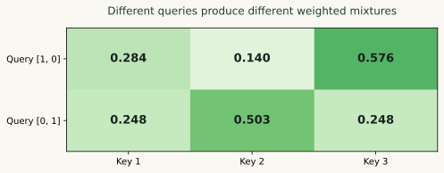

# Understand attention, one weighted sum at a time

<div class="genai-phase">MODEL FOUNDATIONS · STEP 05 OF 32</div>

**After this chapter:** Calculate queries, keys, values and a causal attention result you can inspect.

**Before you start:** [04 · Represent meaning with embeddings](embeddings.md). Keep the [glossary](glossary.md) nearby when a term is new.

## Ask which information this position needs {#intuition}

In “The learner opened the guide because it contained examples,” a useful representation of “it” depends on information elsewhere in the sequence. Attention computes a weighted combination of available information for each query position.

A **query** describes what a position is looking for. A **key** helps another position advertise what it contains. A **value** is the information returned when that position receives weight. Learned projections produce these vectors from token representations. Keys and values can come from the same sequence as the queries or from a different encoded input.

## Calculate a weighted sum {#qkv}

For one query, compute its dot product with each key, divide by the square root of the key dimension and apply softmax. Multiply each value by its weight and add the weighted values. The result is a new representation, rather than a selected word.



```python
import math

def dot(left, right):
    return sum(x*y for x, y in zip(left, right))

def weights(scores):
    maximum = max(scores)
    values = [math.exp(score - maximum) for score in scores]
    return [value / sum(values) for value in values]

query = [1.0, 0.0]
keys = [[1.0, 0.0], [0.0, 1.0], [2.0, 0.0]]
values = [[1.0, 0.0], [0.0, 1.0], [1.0, 1.0]]
scores = [dot(query, key) / math.sqrt(2) for key in keys]
attention = weights(scores)
output = [sum(weight * value[column] for weight, value in zip(attention, values)) for column in range(2)]
assert math.isclose(sum(attention), 1.0)
assert attention[2] > attention[0] > attention[1]
assert len(output) == 2
```

The scale keeps score magnitudes more manageable as the number of key dimensions grows. The full matrix form is `softmax(Q Kᵀ / sqrt(d_k)) V`. Write down the shapes: `[queries, key_dim]` times `[key_dim, keys]` gives `[queries, keys]`; multiplying those weights by `[keys, value_dim]` gives `[queries, value_dim]`.

## Mask information that is unavailable {#masking}

A causal query at position 1 may read positions 0 and 1, but not position 2. A mask excludes future positions before normalization. Renormalizing the remaining weights matters; simply zeroing one final output component is a different operation.

```python
query_position = 1
masked_scores = [score if index <= query_position else -math.inf for index, score in enumerate(scores)]
causal_weights = weights(masked_scores)
assert causal_weights[2] == 0.0
assert math.isclose(sum(causal_weights), 1.0)
```

Keep at least one valid key for each query. If every score is masked, softmax is undefined. Padding masks serve a different purpose: they prevent padded positions from contributing as evidence.

## Explore the calculation {#explorer}

The explorer uses fixed toy scores and values. Its score-temperature control makes concentration visible; an ordinary scaled-dot-product attention layer uses its defined score scale, rather than automatically exposing this as a user setting.

<div class="genai-lab" data-genai-attention>
  <strong>Attention explorer</strong>
  <label for="attention-query">Query position</label>
  <select id="attention-query" data-attention-query><option value="0">Position 1</option><option value="1" selected>Position 2</option><option value="2">Position 3</option></select>
  <label for="attention-temperature">Toy score temperature</label>
  <input id="attention-temperature" data-attention-temperature type="range" min="0.25" max="2" step="0.25" value="1">
  <label class="genai-checkbox"><input type="checkbox" data-attention-mask checked> Use a causal mask</label>
  <table><thead><tr><th>Key</th><th>Value</th><th>Weight</th></tr></thead><tbody><tr><td>1</td><td>[1, 0]</td><td data-attention-weight>—</td></tr><tr><td>2</td><td>[0, 1]</td><td data-attention-weight>—</td></tr><tr><td>3</td><td>[1, 1]</td><td data-attention-weight>—</td></tr></tbody></table>
  <p data-attention-output role="status" aria-live="polite">The Python calculation above works through the same operation.</p>
</div>

## Place attention in its historical context {#forms}

Classical encoder–decoder attention lets an output position consult encoded input positions. Additive attention learns a scoring function; dot-product attention uses vector products. Self-attention takes queries, keys and values from one sequence, while cross-attention combines information from different streams. The original [Transformer paper](https://arxiv.org/abs/1706.03762) provides the architecture that the next chapters assemble.

An attention weight is an internal computational quantity. It is useful to inspect, but it is not automatically a faithful explanation of every cause behind a model's answer.

## Try it yourself {#practice}

Predict the explorer weights when the query is at position 1 and the causal mask is on. Then move to position 3 and change the toy temperature. Explain both the normalization and the change in concentration.

## Check your understanding {#self-check}

If a future token receives weight zero, can it still influence the result through an earlier representation that already saw the future?

??? question "Check your reasoning"
    Yes. A causal mask in one layer does not repair future information leaked earlier. Input construction and the entire computation must respect the prediction boundary. For a causal decoder, earlier hidden states also need to be causally constructed.

## Continue in order {#continue}

**Previous:** [04 · Represent meaning with embeddings](embeddings.md)<br>
**Next:** [06 · Multi-head attention and efficient inference](attention-efficiency.md)

**Source reading:** [Attention](https://aman.ai/primers/attention/). The explanations and numerical examples on this page are original BuildMyX teaching material. Use the linked primers for further detail and their research bibliographies.
