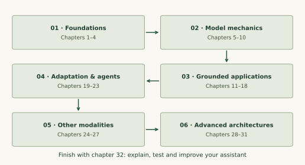

# Start learning Generative AI

<div class="genai-phase">FOUNDATIONS · STEP 01 OF 32</div>

**After this chapter:** Explain a generative system, set up the small labs and choose a practical learning goal.

**Before you start:** [Course overview](index.md). Keep the [glossary](glossary.md) nearby when a term is new.

## Start with a task, an input and a useful result {#task}

Imagine a small team answering questions about its workshops. A learner asks, “Which session covers Python functions?” A useful system finds the right session, explains its relevance and links to the supporting information. It should also recognize a question its materials cannot answer.

A **generative model** learns patterns that let it produce a new sequence or sample: text, an image, audio, a video or an action trajectory. A **predictive task** might assign one label or estimate a number. The same architecture can support different tasks; the training objective and the interface determine what you ask it to do.

A model is one component of an application. Our assistant also needs documents, retrieval, access rules, response validation, evaluation and a way to recover from failures. Keeping those parts visible makes a mistake easier to diagnose.

| Term | In the workshop example |
| --- | --- |
| Model | A learned function that assigns scores or generates a response |
| Prompt | The instructions and input presented for one request |
| Context | All information available to the model during that request |
| Retrieval | Finding relevant information outside the model's parameters |
| Training | Updating learned parameters from examples |
| Inference | Using the learned parameters for a new input |
| Evaluation | Checking a result against defined evidence and criteria |

## Follow the prerequisite chain {#route}

Work through chapters 1–4 before attention. Chapters 5–10 explain the model behind text generation. Chapters 11–18 build an application and an evaluation habit. Chapters 19–23 introduce adaptation and controlled workflows. Chapters 24–31 extend the same ideas to other modalities and architectures. Chapter 32 turns your work into a reproducible capstone.

You can finish a useful first project at chapter 15 and improve it through chapter 23 before studying the advanced material. The numbered route still connects every chapter; the advanced lessons explain which earlier concepts they reuse.



## Prepare a small practice environment {#setup}

Read the explanations first, predict the result of a worked example, then run it. Core Python blocks use **Python 3.12 or newer and the standard library**. Run blocks in order within a chapter, and start a fresh script for the next chapter. Each chapter's program is also in the [lab download](assets/generative-ai-labs.zip).

```sh
python3 --version
python3 -m venv .venv
# macOS / Linux
source .venv/bin/activate
# Windows PowerShell: .venv\Scripts\Activate.ps1
```

If Python functions, lists or dictionaries are unfamiliar, begin with our [Python learning path](../python/index.md). Our [PyTorch path](../pytorch/index.md) is a useful next step when you want to implement trainable tensor models.

The numerical labs make individual operations inspectable on a CPU. The assistant projects use a deterministic extractive responder and a fictional document collection. You can inspect their retrieval, citations and failure states before connecting a model service. Performance on these tiny examples is a learning check, rather than evidence of production model quality.

## Give your project a contract {#contract}

```python
contract = {
    "task": "answer workshop questions using approved documents",
    "inputs": ["question", "reader_role"],
    "outputs": ["answer", "citations", "status"],
    "success": "supported answer or an explicit abstention",
}
assert "citations" in contract["outputs"]
assert contract["success"].endswith("explicit abstention")
```

Notice that this contract defines an outcome before choosing a model. Later, the same contract will guide retrieval tests, judge rubrics and workflow termination.

## Try it yourself {#practice}

Write a three-line contract for a different application. Name its input, its acceptable output and one case where it should ask for more information.

## Check your understanding {#self-check}

A fluent answer names a session that does not exist in the documents. Has the assistant met its contract?

??? question "Check your reasoning"
    No. Fluency is a surface property. The contract requires support from approved evidence or an abstention. First inspect retrieval and the cited source, then examine generation and response validation.

## Continue in order {#continue}

**Previous:** [Course overview](index.md)<br>
**Next:** [02 · The math behind a prediction](math-and-learning.md)

**Source reading:** [Language models](https://aman.ai/primers/LLM/). The explanations and numerical examples on this page are original BuildMyX teaching material. Use the linked primers for further detail and their research bibliographies.
