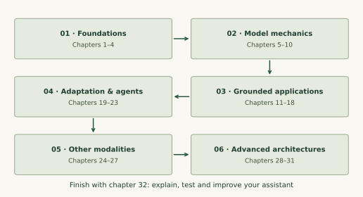

BUILDMYX LEARN / GENERATIVE AI

# Understand the model. Build a system you can explain.

Start with tokens, vectors and one prediction. Follow a guided sequence through attention and transformers, build a grounded assistant, then explore the models behind images, multimodal understanding and embodied intelligence.

32 ordered chapters16 source primersSmall Python labsNo sign-up

[Start learning Generative AI →](getting-started.md){ .md-button .md-button--primary }
[See the learning sequence](#learning-sequence){ .md-button }

## Begin here, even if the field feels crowded {#start}

Read in chapter order. Each lesson names its prerequisite, explains the concept, works through an example and ends with a self-check and a next step. The first chapters introduce the mathematical notation used later. If writing Python is new, use the [Python learning path](../python/index.md) alongside the explanations.

The core labs use **Python 3.12+ and the standard library**, so you can inspect the mechanics on a CPU. The project responders are deterministic and extractive, with fictional workshop records; a real language-model adapter is a later extension behind the same response contract. The website displays lessons and interactive numerical examples. Exercise answers and reading progress are not saved.

## Your learning sequence {#learning-sequence}

### 01 · Foundations

| Chapter | Learn to… |
| --- | --- |
| [01 · Start learning Generative AI](getting-started.md) | Explain a generative system, set up the small labs and choose a practical learning goal. |
| [02 · The math behind a prediction](math-and-learning.md) | Use vectors, probability, loss and a small gradient update without skipping the notation. |
| [03 · Tokens and language modeling](tokens-and-language.md) | Follow text through token IDs, causal prediction and a language-model objective. |
| [04 · Represent meaning with embeddings](embeddings.md) | Compare lexical and learned representations, compute similarity and choose a retrieval representation. |

### 02 · Model foundations

| Chapter | Learn to… |
| --- | --- |
| [05 · Understand attention, one weighted sum at a time](attention.md) | Calculate queries, keys, values and a causal attention result you can inspect. |
| [06 · Multi-head attention and efficient inference](attention-efficiency.md) | Separate model structure, attention approximation and hardware-efficient implementation. |
| [07 · Assemble a transformer](transformers.md) | Connect attention, residual paths, normalization, positions and feed-forward blocks. |
| [08 · How language models are trained](training-llms.md) | Distinguish pretraining, instruction tuning and preference optimization, with sound data splits. |
| [09 · Generate the next token](decoding.md) | Use temperature, top-k, nucleus sampling and stopping rules deliberately. |
| [10 · Serve a model and manage long context](serving-and-context.md) | Reason about prefill, decoding, memory, context extension and latency budgets. |

### 03 · Grounded applications

| Chapter | Learn to… |
| --- | --- |
| [11 · Write instructions and validate outputs](prompting.md) | Build a clear task contract, useful examples and a checked structured response. |
| [12 · Engineer the context](context-engineering.md) | Select and budget instructions, evidence, state and memory while retaining provenance. |
| [13 · Build a retrieval-augmented generation pipeline](rag.md) | Follow ingestion, retrieval, context assembly and cited generation end to end. |
| [14 · Improve retrieval and choose a RAG design](retrieval-strategies.md) | Use hybrid retrieval, reranking, query transformations and multi-hop designs when evidence supports them. |
| [15 · Project: a grounded workshop assistant](grounded-assistant.md) | Build a small inspectable retrieval-and-answer prototype with citations and an abstention path. |
| [16 · Measure quality before changing the system](evaluation.md) | Evaluate retrieval and answers separately, using held-out cases and meaningful baselines. |
| [17 · Evaluate with a calibrated LLM judge](llm-judges.md) | Design pointwise, pairwise and listwise judgments, then check bias and human agreement. |
| [18 · Operate and improve a GenAI application](operations.md) | Trace failures, budget cost and latency, and release a versioned system through explicit checks. |

### 04 · Adaptation and agents

| Chapter | Learn to… |
| --- | --- |
| [19 · Adapt a model with parameter-efficient tuning](fine-tuning.md) | Choose a tuning method and understand what a LoRA or quantized-base update changes. |
| [20 · Transfer behavior with knowledge distillation](distillation.md) | Compare teacher-student objectives, data policies and the evidence needed to assess a smaller model. |
| [21 · Design a bounded agent loop](agent-loops.md) | Define state, observations, tool contracts, progress checks and termination before adding autonomy. |
| [22 · Connect work with a reliable graph](agent-graphs.md) | Choose graph topologies, handle parallel results and define recovery at every boundary. |
| [23 · Project: an assistant workflow you can replay](workflow-project.md) | Connect retrieval, verification and a checkpointed controller with explicit failure states. |

### 05 · Other generative models

| Chapter | Learn to… |
| --- | --- |
| [24 · Learn to reverse a noising process](diffusion.md) | Understand the forward process, learned denoising and what an inference sampler actually does. |
| [25 · Condition image and video generation](conditional-diffusion.md) | Compare latent models, U-Nets, DiTs, guidance and sampling or adaptation choices. |
| [26 · Connect images and language](vision-language.md) | Distinguish aligned embeddings, multimodal fusion and generative vision-language models. |
| [27 · Build and evaluate a multimodal system](multimodal-systems.md) | Keep spatial and temporal evidence intact through multimodal retrieval, generation and evaluation. |

### 06 · Advanced architectures

| Chapter | Learn to… |
| --- | --- |
| [28 · Model sequences with a state-space model](state-space-models.md) | Trace recurrent state, structured and selective SSMs, and their memory trade-offs. |
| [29 · Understand recursive computation](recursive-transformers.md) | Separate repeated model depth, latent reasoning and recursive program-controlled model calls. |
| [30 · Predict a world and plan within it](world-models.md) | Distinguish rendering, simulation, latent prediction and planning with an imperfect learned model. |
| [31 · Connect perception, prediction and action](physical-ai.md) | Understand VLA policies, data, simulation and the requirements of closed-loop embodied evaluation. |

### 07 · Finish the path

| Chapter | Learn to… |
| --- | --- |
| [32 · Capstone: explain, test and improve your assistant](capstone.md) | Produce a reproducible prototype, an evaluation report and a justified next experiment. |

## Make progress through a real artifact {#projects}

- **Chapter 15:** build a grounded workshop assistant with visible retrieval, citations and abstention.
- **Chapter 23:** connect the assistant to an explicit workflow with checkpoints, verification and replay identity.
- **Chapter 32:** run the downloadable prototype, add evaluation cases and write a reproducible comparison report.

Complete the text-system project before adding another modality. The later chapters explain how diffusion, VLMs, state-space models, recursion and world models fit into the same practice of testing an input-to-output contract.

## Keep a reference beside the lesson {#resources}

Use the [glossary](glossary.md) for a definition and a route back to a concept. The [source guide](sources.md) maps all 16 supplied primers into the course and links to deeper research. The repeated loop-and-graph URL is treated as one source.

[Download the chapter labs and capstone](assets/generative-ai-labs.zip){ .md-button }

The download contains original teaching programs, assertions, fictional fixtures and a README. It does not include model weights or source articles. To move from numerical sketches to trainable neural modules, continue with the [PyTorch learning path](../pytorch/index.md).

## Bring an evaluation question {#support}

Share a small example, the result you expected and the evidence you used to check it. We can discuss whether guided learning or project feedback is a useful next step.

[Discuss Generative AI learning support ↗](/?interest=learning#enquire){ .md-button .md-button--primary }
