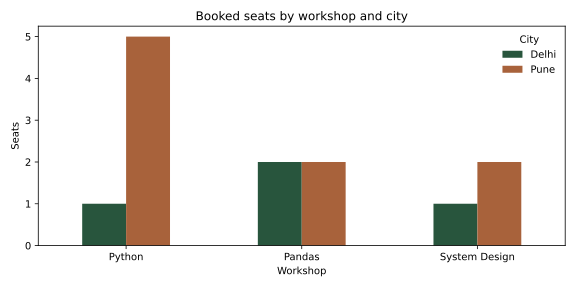

# Plot an answer

## Choose a chart that answers a question {#choosing}

pandas plotting uses matplotlib by default. A line chart shows a meaningful ordered progression, a bar chart compares categories, a histogram shows a distribution and a scatter plot compares paired numeric measures. The chart should make the unit, population and time window clear. Category codes are not continuous measurements.

The examples save files into your practice directory. Use `plt.show()` in a desktop session if you want an interactive window, or display the axes in a notebook. In an automated environment, choose matplotlib's non-interactive `Agg` backend. Close figures when finished so a long analysis does not retain every chart in memory.

## Plot a Series {#series-plot}

A Series uses its index for horizontal labels. Sort a time index before drawing a time progression. Calling `.plot()` returns a matplotlib Axes object that you can label and customize.

```python
import pandas as pd
import matplotlib.pyplot as plt
from pathlib import Path

daily = pd.Series([3, 4, 3, 3], index=pd.date_range("2026-10-01", periods=4, freq="D"), name="seats")
ax = daily.plot(kind="line", marker="o", color="#28553d", figsize=(7, 4))
ax.set(title="Workshop seats booked per day", xlabel="Booking date · October 2026", ylabel="Seats")
ax.set_ylim(bottom=0)
ax.figure.tight_layout()
ax.figure.savefig("daily-seats.png", dpi=150)
assert ax.get_ylabel() == "Seats"
assert Path("daily-seats.png").stat().st_size > 0
plt.close(ax.figure)
```

The values are fictional and represent bookings, not attendance. A zero on a completed day means no observed bookings; an unknown collection period should not be plotted as a confirmed zero.

## Plot a DataFrame {#dataframe-plot}

A DataFrame can plot several numeric columns as separate series. Select the columns you intend to compare; mixing amounts and counts on one axis gives incompatible units. A grouped bar chart can compare workshops across cities with the same unit.

```python
seats = pd.DataFrame({"Delhi": [1, 2, 1], "Pune": [5, 2, 2]}, index=["Python", "Pandas", "System Design"])
ax = seats.plot.bar(color=["#28553d", "#a8623b"], figsize=(8, 4), rot=0)
ax.set(title="Booked seats by workshop and city", xlabel="Workshop", ylabel="Seats")
ax.legend(title="City", frameon=False)
ax.figure.tight_layout()
ax.figure.savefig("workshop-seats.svg")
assert len(ax.patches) == 6
plt.close(ax.figure)
```

<figure markdown>

<figcaption>Synthetic course data. All bars use the same seat-count scale and start at zero.</figcaption>
</figure>

The original chart above is generated from the example. When sharing a chart, include the data window and a description of its values so the conclusion is available without relying only on color.

## Group, count, unstack and plot {#grouped-plot}

Combine the techniques from earlier chapters to build the chart's input table. Grouping counts rows; unstacking turns a category into a separate plotted series. Fill missing combinations only if an absent record truly represents zero for this dataset.

```python
bookings = pd.DataFrame({"city": ["Pune", "Pune", "Delhi", "Delhi"], "mode": ["Online", "In person", "Online", "Online"]})
counts = bookings.groupby(["city", "mode"]).size().unstack("mode", fill_value=0)
assert counts.loc["Delhi", "Online"] == 2
ax = counts.plot(kind="bar", stacked=True, rot=0, figsize=(6, 4))
ax.set(title="Bookings by delivery mode", ylabel="Bookings", xlabel="City")
ax.figure.tight_layout()
ax.figure.savefig("delivery-modes.png", dpi=150)
plt.close(ax.figure)
```

A stacked bar is useful for totals and composition, but comparing a segment without a shared baseline can be difficult. Use grouped bars when direct category comparison is the main question.

## Distributions and relationships {#other-plots}

Histograms divide numeric values into bins. The bin boundaries affect the apparent distribution, especially for small samples. Scatter plots show paired measurements; an association does not establish why one value changed.

```python
observations = pd.DataFrame({"seats": [1, 1, 2, 2, 3, 4], "minutes": [20, 25, 28, 35, 40, 44]})
ax = observations["minutes"].plot.hist(bins=[15, 25, 35, 45], edgecolor="white")
ax.set(xlabel="Practice duration · minutes", ylabel="Observations", title="Synthetic practice durations")
ax.figure.savefig("duration-histogram.png", dpi=150, bbox_inches="tight")
plt.close(ax.figure)
ax = observations.plot.scatter(x="seats", y="minutes", color="#28553d")
ax.set(xlabel="Seats in booking", ylabel="Practice duration · minutes", title="Two measurements, six observations")
ax.figure.savefig("duration-scatter.png", dpi=150, bbox_inches="tight")
plt.close(ax.figure)
```

Save PNG for a convenient raster image or SVG for scalable figures. Keep the source table and generation code alongside a report so another person can reproduce and inspect the numbers behind the picture.

## Practice

A mean rating rises while the number of ratings falls sharply. What should you show with the mean?

??? question "Check your reasoning"
    Show the sample count, eligible population and missing-data rate for each period. A line alone can imply a stronger trend than the observations support. Choose a scale and annotation that make the limited sample visible.
