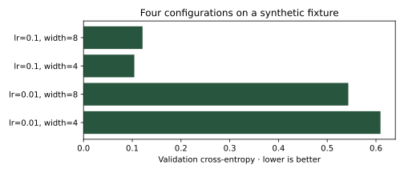

# Design and track useful experiments

## Decide what a comparison can establish {#principles}

Keep the split, metric, preprocessing and compute budget fixed when comparing an architectural choice. Isolating one variable makes a small experiment interpretable; a factorial grid deliberately studies combinations. Record every run, including failures, rather than preserving only the best number.

A learning rate controls update size: too large can destabilize optimization; too small can waste the budget. Search logarithmically when useful values span orders of magnitude. Batch size, dropout, hidden width, weight decay and number of epochs interact, so a winning learning rate is conditional on the rest of the configuration.

## A complete, small trial function {#trial}

The fixture below has a fixed training/validation partition. `run_trial` creates a new model and optimizer every time, eliminating weight leakage between configurations. The same procedure can wrap a CNN trial or a padded-text/LSTM trial, provided each retains its correct batch interface.

```python
import json
import time
from pathlib import Path
import torch
from torch import nn

generator = torch.Generator().manual_seed(30)
features = torch.randn(80, 2, generator=generator)
labels = features[:, 0].gt(0).long()
train_x, validation_x = features[:56], features[56:]
train_y, validation_y = labels[:56], labels[56:]

def run_trial(lr, width, seed=31, epochs=15):
    torch.manual_seed(seed)
    model = nn.Sequential(nn.Linear(2, width), nn.ReLU(), nn.Linear(width, 2))
    optimizer = torch.optim.AdamW(model.parameters(), lr=lr)
    started = time.perf_counter()
    for _ in range(epochs):
        model.train()
        optimizer.zero_grad(set_to_none=True)
        loss = nn.functional.cross_entropy(model(train_x), train_y)
        loss.backward()
        optimizer.step()
    model.eval()
    with torch.inference_mode():
        logits = model(validation_x)
        val_loss = nn.functional.cross_entropy(logits, validation_y).item()
        accuracy = logits.argmax(1).eq(validation_y).float().mean().item()
    return {"lr": lr, "width": width, "seed": seed, "epochs": epochs,
            "validation_loss": val_loss, "accuracy": accuracy,
            "seconds": time.perf_counter() - started}

trial = run_trial(0.03, 4)
assert 0 <= trial["accuracy"] <= 1 and trial["validation_loss"] >= 0
```

Never choose a configuration by repeatedly inspecting the final test set. Validation can itself be overfit after extensive searching; keep the search budget visible and report the final untouched test evaluation once the procedure is selected.

## Grid search, random search and early stopping {#grid-search}

Grid search checks every chosen combination. Random search can cover more distinct values of important dimensions under the same budget. Bayesian/adaptive methods use prior trial results to propose promising configurations, but their advantage depends on the objective, budget and noise. None guarantees a global optimum.

```python
from itertools import product

results = [run_trial(lr, width) for lr, width in product([0.01, 0.1], [4, 8])]
best = min(results, key=lambda row: row["validation_loss"])
assert len(results) == 4
assert best in results
Path("grid-results.json").write_text(json.dumps(results, indent=2), encoding="utf-8")
```

For CNN trials, vary channel width or dropout while retaining CIFAR-10's split and transforms. For IMDb sentiment trials, vary embedding/hidden width, length limits or learning rate while keeping the training-only tokenizer artifact fixed. Early stopping can save work on poor trials; use comparable stopping rules and log the effective epochs.

## Automated tuning with Optuna {#optuna}

This example uses Optuna 5.0.0 with a seeded TPE sampler and an in-memory study. `direction="minimize"` matches validation loss. Report intermediate metrics and call `trial.should_prune()` inside a longer training loop if you use a pruner; pruning is an optimization decision, not missing data to discard from the report.

```python
import optuna

optuna.logging.set_verbosity(optuna.logging.WARNING)
def objective(trial):
    lr = trial.suggest_float("lr", 0.001, 0.1, log=True)
    width = trial.suggest_categorical("width", [4, 8])
    return run_trial(lr, width)["validation_loss"]

study = optuna.create_study(direction="minimize", sampler=optuna.samplers.TPESampler(seed=32))
study.optimize(objective, n_trials=3)
assert len(study.trials) == 3
assert study.best_value >= 0
```

A persistent storage backend can resume a study; keep dataset/model versions and objective definitions with it. Reusing a study name for a changed objective makes its history difficult to interpret.

W&B Sweeps can coordinate a configured search with agents and its tracking service. Lightning Tuner provides helpers inside the Lightning training framework, such as learning-rate or batch-size exploration. They are alternatives around the same underlying experiment contract, rather than reasons to change the held-out data or metric between trials.

## Configuration with Hydra {#hydra}

Hydra separates experiment settings from code and composes configurations with overrides. The runnable example uses Hydra 1.3.8 and a local YAML file. A larger project can use `conf/model/`, `conf/data/` and a `defaults` list to compose model/data choices.

```python
from hydra import initialize_config_dir, compose

Path("conf").mkdir(exist_ok=True)
Path("conf/config.yaml").write_text("trainer:\n  lr: 0.03\n  epochs: 15\nmodel:\n  width: 4\n", encoding="utf-8")
with initialize_config_dir(version_base="1.3", config_dir=str(Path("conf").resolve())):
    config = compose(config_name="config", overrides=["trainer.lr=0.1"])
assert config.trainer.lr == 0.1
assert config.model.width == 4
```

For a CLI entry point, decorate a function with `@hydra.main(version_base="1.3", config_path="conf", config_name="config")`. Save the resolved configuration, not only the override string. Current Hydra does not always change the working directory by default; set `hydra.job.chdir` deliberately and resolve dataset paths accordingly.

## Log with TensorBoard and W&B locally {#logging}

TensorBoard records events in a directory. W&B can log configurations, metrics and artifacts, including an **offline** mode that does not need a cloud account. The examples use TensorBoard and W&B 0.31.0 locally; they do not upload data or create an external experiment project.

```python
from torch.utils.tensorboard import SummaryWriter

writer = SummaryWriter(log_dir="runs/teaching")
writer.add_scalar("loss/validation", best["validation_loss"], 0)
writer.add_scalars("accuracy", {"validation": best["accuracy"]}, 0)
writer.close()
assert list(Path("runs/teaching").glob("events.*"))
```

```python
import wandb

with wandb.init(project="buildmyx-learning", mode="offline", dir=str(Path.cwd()),
                config={"seed": 31, "fixture": "synthetic-boundary-v1"},
                settings=wandb.Settings(quiet=True)) as run:
    for index, row in enumerate(results):
        run.log({"trial": index, "validation_loss": row["validation_loss"], "accuracy": row["accuracy"]})
    run.summary["best_validation_loss"] = best["validation_loss"]
assert list(Path("wandb").glob("offline-run-*"))
```

Run `tensorboard --logdir runs` locally to inspect events. Choose an explicit upload/sync policy if you later connect a tracking service. Log both training and validation curves so improvement on training with deterioration on validation is visible.

## Visualize and reproduce the result {#visualization}

```python
import matplotlib.pyplot as plt

fig, ax = plt.subplots(figsize=(7, 3))
names = [f"lr={row['lr']}, width={row['width']}" for row in results]
ax.barh(names, [row["validation_loss"] for row in results], color="#28553d")
ax.set(xlabel="Validation cross-entropy · lower is better", title="Four configurations on a synthetic fixture")
fig.tight_layout()
fig.savefig("hyperparameter-results.svg")
plt.close(fig)
assert Path("hyperparameter-results.svg").is_file()
```

<figure markdown>

<figcaption>A teaching experiment, generated by the code above. It is not a CIFAR-10 or IMDb benchmark.</figcaption>
</figure>

Repeat shortlisted configurations across several seeds, keep preprocessing and data order controlled, and record the environment. A single lucky seed does not establish that an architectural change caused an improvement. The next chapter explains uncertainty and paired comparisons.

## Practice

You retain a model's weights between learning-rate trials to save time. Why is that no longer a fair comparison of fresh training configurations?

??? question "Check your reasoning"
    Later trials inherit optimization work and potentially useful weights from earlier trials. Recreate the model and optimizer for each independent trial, or explicitly define the experiment as continuation/resumption with that history included in its compute budget.
